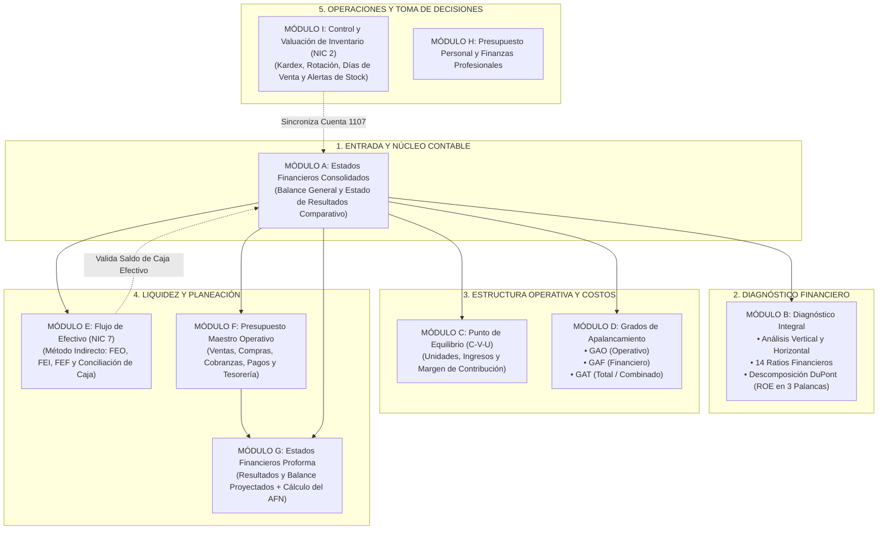

# Guía Maestra de Defensa Académica y Arquitectura del Sistema Financiero
**GFO - IS2122 | Sistema de Análisis, Planeación y Decisión Financiera**

---

## 1. Visión Global: ¿Qué es el Sistema y cómo opera?

El sistema no es una simple hoja de cálculo ni una base de datos estática: es un **Ecosistema Financiero Reactivo en Cascada (Módulos A al I)**. 
Cada módulo cumple una función canónica de la administración financiera moderna (bajo principios de **NIC 1, NIC 2, NIC 7 y NIIF**), y todos los datos fluyen en una sola dirección coherente:

---

## 2. Mapa de Conexión en Cascada: De Dónde Salen y a Dónde Van los Datos

| Módulo | Nombre | Datos de Entrada (De dónde vienen) | Cálculos y Lógica Central | Destino (A dónde se conectan) |
| :--- | :--- | :--- | :--- | :--- |
| **Módulo A** | **Estados Financieros** | Documento subido (PDF, Excel, CSV, MD) o digitación directa de saldos (2 períodos). | Cuadre de Balance ($Activo = Pasivo + Patrimonio$), cálculo de $Utilidad Bruta$, $UAII$, $UAI$ e $Impuesto$. | Es el corazón: alimenta a **B, C, D, E, F y G**. |
| **Módulo B** | **Diagnóstico y DuPont** | Cuentas y totales calculados del Módulo A. | Vertical (% sobre base), Horizontal ($\Delta$ Absoluta y Relativa), 14 razones (Liquidez, Actividad, Deuda, Rentabilidad) y DuPont ($Margen \times Rotación \times Apalancamiento$). | Dictamen ejecutivo y evaluación del riesgo para el Proforma (**G**). |
| **Módulo C** | **Punto de Equilibrio** | $P$, $CVu$, $Q$ (extraídos o inferidos de Ventas Netas y Costo de Ventas del Módulo A) y Gastos Operativos Fijos. | Margen de Contribución Unitario ($P - CVu$), % Margen, $Q_e = \frac{CF}{P - CVu}$, $Ventas_e = \frac{CF}{\%MC}$. | Define el piso mínimo operativo antes de proyectar metas en **F y G**. |
| **Módulo D** | **Apalancamiento** | $UAII$, Intereses Financieros y Costos Fijos de A y C. | $GAO = \frac{Q \times (P - CVu)}{UAII}$, $GAF = \frac{UAII}{UAII - I}$, $GAT = GAO \times GAF$. | Mide la volatilidad y riesgo de utilidad neta ante caídas de ventas proyectadas en **G**. |
| **Módulo E** | **Flujo de Efectivo** | Utilidad Neta de A, más variaciones de capital de trabajo ($\Delta CxC, \Delta Inventario, \Delta CxP$) y activos/deudas. | NIC 7 (Método Indirecto): Actividades de Operación (FEO), Inversión (FEI) y Financiamiento (FEF). | Verifica si el Efectivo del Balance General es generado por el negocio o por deuda. |
| **Módulo F** | **Presupuesto Maestro** | Cierre de ventas, inventario inicial, CxC y CxP del Módulo A, más pautas de crecimiento del usuario. | Presupuesto de Ventas, Compras, Cobranzas (efectivo vs crédito), Desembolsos y Saldo Final de Caja mensual/anual. | Es el motor operativo que construye automáticamente los Estados Proforma (**G**). |
| **Módulo G** | **Estados Proforma** | Datos del Módulo A combinados con los resultados del Presupuesto Maestro (**F**). | Proyección de Resultados y Balance General Proforma. Determinación del **AFN (Fondos Externos Necesarios)**. | Toma de decisiones de financiamiento: ¿se requiere crédito bancario o aporte de capital? |
| **Módulo I** | **Control de Inventarios** | Registros de existencias físicas: SKU, existencias iniciales, entradas, salidas y costos unitarios. | Costo Promedio Ponderado, Valor Total de Inventarios, Rotación Anual ($Costo / Inv$), Días de Inventario y Alertas. | Sincroniza directamente con la cuenta `1107 Inventarios` del Módulo A y apoya a **F**. |

---

## 3. Foco Especial: MÓDULO G — Estados Financieros Proforma y el AFN

### ¿Qué es y cuál es su objetivo financiero?
El Módulo G responde a la pregunta decisiva del Director Financiero (CFO): 
> *"Si la empresa incrementa sus ventas un X% el próximo año, ¿cuánto dinero adicional necesitaremos pedir prestado al banco o a los socios para no quebrar por falta de liquidez?"*

### ¿De dónde salen los datos del Proforma?
1. **Del Módulo A (Cierre Actual - Año Base):**
   - Nivel de activos que varían espontáneamente con las ventas (Efectivo, Cuentas por Cobrar, Inventarios).
   - Pasivos espontáneos que crecen automáticamente al crecer las operaciones (Cuentas por pagar a proveedores y gastos acumulados).
   - Margen neto histórico y dividendos distribuidos.
2. **Del Módulo F (Presupuesto Maestro):**
   - Pronóstico de unidades a vender y precio proyectado.
   - Presupuesto de compras de materia prima / mercadería.
   - Inversión en activos fijos (CAPEX planeado).

### ¿Cómo se calculan los Estados Proforma?
1. **Estado de Resultados Proforma:**
   $$\text{Ventas Proyectadas} = \text{Ventas Actuales} \times (1 + g)$$
   $$\text{Costo de Ventas Proyectado} = \text{Ventas Proyectadas} \times \left(\frac{\text{Costo Actual}}{\text{Ventas Actuales}}\right)$$
   $$\text{Gastos Operativos Proyectados} = \text{Gastos Fijos} + \text{Gastos Variables Proyectados}$$
   $$\text{UAII Proforma} = \text{Ventas Proyectadas} - \text{Costo Proyectado} - \text{Gastos Proyectados}$$
   $$\text{Utilidad Neta Proforma} = (\text{UAII} - \text{Intereses}) \times (1 - t)$$

2. **Acumulación de Utilidades Retenidas:**
   $$\Delta \text{Utilidades Retenidas} = \text{Utilidad Neta Proforma} - \text{Dividendos Proyectados}$$

3. **Balance General Proforma y Ecuación del AFN:**
   Al crecer las ventas, la empresa necesita más activos (más inventario, más cuentas por cobrar, más maquinaria). 
   - **Activos Totales Proforma ($A^*$):** Suma de todos los activos requeridos para soportar las ventas.
   - **Pasivos y Patrimonio Espontáneos ($L^* + E^*$):** Pasivos corrientes operativos + Deuda existente + Capital social + Utilidades retenidas incrementadas.
   
   $$\mathbf{AFN = \text{Total Activos Proforma} - (\text{Total Pasivos Proforma} + \text{Patrimonio Proforma})}$$

> **Interpretación Clave ante el Profesor:**
> - Si **$AFN > 0$ (Faltante de Fondos):** La empresa requiere financiamiento externo (préstamo bancario de corto/largo plazo o emisión de nuevas acciones) porque el crecimiento supera la capacidad interna de reinversión.
> - Si **$AFN < 0$ (Superávit de Fondos):** La empresa genera más flujo de efectivo interno del necesario para crecer; ese excedente puede usarse para pagar deuda vieja, invertir en títulos o recomprar acciones.

---

## 4. Foco Especial: MÓDULO I — Control y Valuación de Inventarios (NIC 2)

### ¿Qué es y cuál es su rol en el sistema?
El Módulo I gestiona el activo realizable más crítico de cualquier empresa comercial o industrial bajo la **Norma Internacional de Contabilidad 2 (NIC 2: Inventarios)**. Realiza el seguimiento operativo por SKU y lo traduce a valor contable monetario.

### Conexión Directa: ¿A dónde va este módulo?
El valor total de existencias calculado en este módulo:
$$\text{Valor Total de Inventario} = \sum_{i=1}^{n} (\text{Stock Final}_i \times \text{Costo Unitario}_i)$$
alimenta directamente la cuenta contable **`1107 - Inventarios, neto`** en el **Balance General del Módulo A**. 

Si un producto tiene entradas o salidas en bodega, el saldo contable de Activos Corrientes y el Capital de Trabajo cambian en tiempo real.

### Fórmulas del Módulo I que debes saber explicar:

1. **Ecuación de Existencia Física (Kardex):**
   $$\text{Stock Final (Unidades)} = \text{Stock Inicial} + \text{Entradas} - \text{Salidas}$$

2. **Valor Monetario del Inventario Final:**
   $$\text{Valor Monetario} = \text{Stock Final} \times \text{Costo Unitario}$$

3. **Rotación del Inventario (Veces al año):**
   $$\text{Rotación de Inventario} = \frac{\text{Costo de Ventas Anual (del Módulo A)}}{\text{Inventario Promedio (o Final)}}$$
   *Mide cuántas veces se vacía y se renueva el almacén en el año.*

4. **Días de Venta de Inventario (DVI / Permanencia en Bodega):**
   $$\text{Días de Inventario} = \frac{365}{\text{Rotación de Inventario}}$$
   *Indica cuántos días pasa la mercadería guardada antes de ser vendida.*

5. **Alertas Automáticas de Stock Mínimo:**
   - Si $\text{Stock Final} < \text{Stock Mínimo}$: Se activa una alerta roja de **"Reposición Urgente"** para evitar quiebre de stock y pérdida de ventas.
   - Si $\text{Stock Final} > 2.5 \times \text{Stock Mínimo}$: Alerta amarilla de **"Posible Sobreinventario"** (costo de almacenamiento y capital inmovilizado innecesario).

---

## 5. Guión Paso a Paso: Cómo Explicarle el Proyecto al Profesor

Cuando el profesor te diga: *"Explíqueme su sistema, de dónde salen los datos y cómo funciona"*, sigue este guión exacto:

### Paso 1: Introducción Contundente (30 segundos)
> *"Profesor, nuestro sistema no es una planilla aislada; es una solución web de **Gestión Financiera Integral** construida con arquitectura modular en cascada. El sistema conecta desde el registro contable auditado en el **Módulo A**, pasando por el diagnóstico financiero y apalancamiento en los **Módulos B, C y D**, hasta la planeación de liquidez y proyecciones estratégicas en los **Módulos E, F, G e I**."*

### Paso 2: El Núcleo de Datos (Módulo A)
> *"Todo parte de los Estados Financieros Comparativos en el **Módulo A**. El sistema valida en tiempo real la ecuación patrimonial: Activo igual a Pasivo más Patrimonio. Si editamos cualquier valor aquí —por ejemplo, si cambian las ventas o los inventarios—, esa cifra no se queda estática: detona un recálculo automático en todos los demás módulos sin necesidad de botones de sincronización manuales."*

### Paso 3: Diagnóstico y Sensibilidad (Módulos B, C y D)
> *"A partir de esos estados, el **Módulo B** evalúa la salud del negocio mediante Análisis Vertical, Horizontal, 14 razones financieras y el Modelo DuPont, que descompone el ROE en tres factores: margen operativo, rotación de activos y apalancamiento financiero. Inmediatamente, los **Módulos C y D** analizan el Punto de Equilibrio y los Grados de Apalancamiento GAO, GAF y GAT, permitiéndonos saber a partir de cuántas unidades la empresa cubre sus costos fijos y qué tan sensible es la utilidad ante caídas en el mercado."*

### Paso 4: La Conexión con Inventarios (Módulo I)
> *"Para el control operativo, el **Módulo I** administra los productos mediante el método de costo promedio bajo NIC 2. Controlamos las existencias iniciales, compras, ventas y stock de seguridad de cada SKU. El valor totalizado de las existencias se conecta directamente con la cuenta de inventarios del Balance General en el Módulo A, garantizando que el almacén físico coincida con la contabilidad."*

### Paso 5: Planeación, Presupuestos y Proformas (Módulos E, F y G)
> *"Finalmente, en los **Módulos E, F y G** cerramos el ciclo gerencial: el Módulo E audita de dónde vino el dinero mediante el Flujo de Efectivo NIC 7 (operativo, inversión y financiamiento). El Módulo F proyecta el Presupuesto Maestro de ventas, cobranzas y compras. Y con eso, el **Módulo G (Estados Proforma)** proyecta el Balance y Estado de Resultados del siguiente año, calculando con exactitud el **AFN (Fondos Externos Necesarios)** para determinar si el crecimiento planeado requiere crédito bancario o si se autofinancia con utilidades retenidas."*

---

## 6. Respuestas a Preguntas Trampa del Profesor

| Pregunta Típica del Profesor | Respuesta Exacta y Técnica |
| :--- | :--- |
| **¿Por qué la utilidad neta no coincide con el dinero en caja?** | *"Porque la utilidad se rige por el **principio de devengado** (ingresos facturados aunque no cobrados y gastos incurridos aunque no pagados), mientras que el efectivo se rige por el **principio de caja**. Por eso creamos el **Módulo E (Flujo de Efectivo NIC 7)**, que concilia la utilidad neta ajustando las partidas no monetarias (como depreciación) y las variaciones del capital de trabajo."* |
| **¿Qué significa si en el Módulo G el AFN resulta negativo?** | *"Significa que la empresa genera un excedente de liquidez interna. La tasa de retención de utilidades y la generación operativa superan el requerimiento de activos para soportar el crecimiento proyectado. Ese dinero puede usarse para pagar deuda anticipada o repartir dividendos."* |
| **¿Por qué en el Módulo I se controlan los días de inventario?** | *"Porque un inventario con demasiados días de permanencia representa **capital de trabajo ocioso**, riesgo de obsolescencia, deterioro y costos financieros por financiamiento de bodega. Una rotación alta reduce el ciclo de conversión de efectivo."* |
| **¿Qué ocurre si cambio un número en una cuenta del Balance?** | *"Gracias a la cascada reactiva del sistema, el cambio se refleja inmediatamente en el capital de trabajo, en los ratios de liquidez del Módulo B, en el cálculo del flujo de efectivo del Módulo E y en las proyecciones del Módulo G."* |
